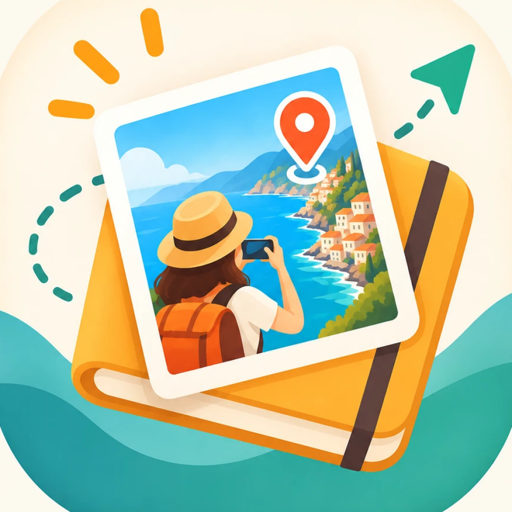
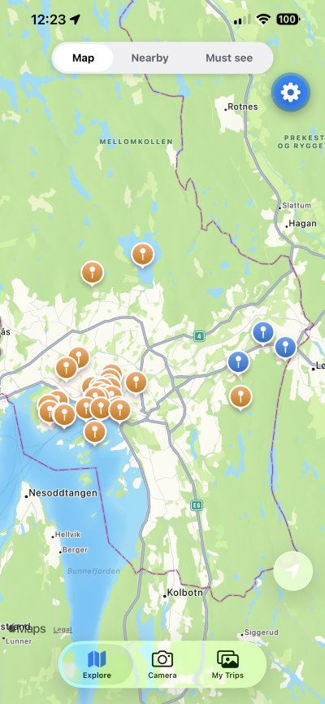
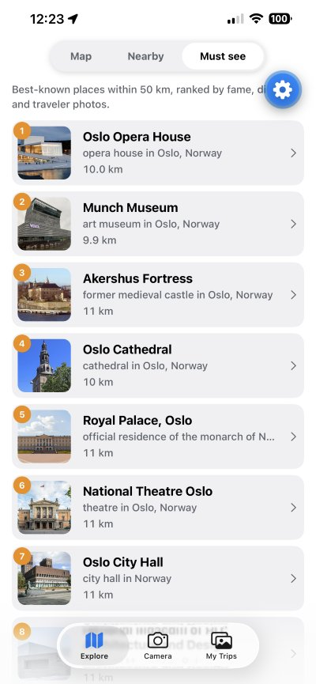
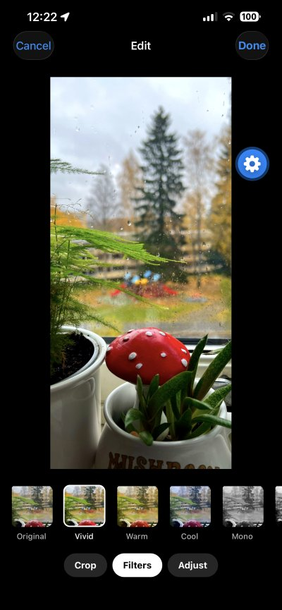

<p align="center">
  
</p>

<h1 align="center">Traveliary</h1>

<p align="center">
  <b>A travel diary in photos.</b> Take a photo where you are, and see who else has been there.<br/>
  iOS & Android · React Native (Expo) · Supabase · <i>Private beta</i>
</p>

---

<p align="center">
  
  
  
  
</p>
<p align="center"><sub>Explore map · Must see · Sight details · Photo editor</sub></p>

## What it does

- **Posting:** you take a photo **in the app**, at the place you're standing. Traveliary tags it with the neighborhood or town ("Grünerløkka, Oslo", "Zermatt, Switzerland") and, once you agree, posts it publicly.
- **Exploring:** others discover places on a **map**, see **who has been there**, and get a **notification** when someone posts at a place they've visited.
- **Must see:** a ranked list of the best-known landmarks, museums, historic sites and nature within 50 km, **anywhere in the world**, with directions and the story from Wikipedia.
- **No sign-up:** each install gets an anonymous identity.

## Features

| | |
|---|---|
| **Capture** | In-app camera only (no gallery uploads), so photos really are taken at the place. Pinch zoom, 0.5× ultra-wide, flash, framing grid. |
| **Edit** | Crop presets (Square, 4:5, 16:9), rotate and flip, 8 filters, and brightness, contrast, saturation and warmth sliders. All live, GPU-rendered with Skia. |
| **Places** | Location is captured at the shutter; the place is resolved on the device and matched on the server by name and distance. |
| **Explore** | Map with place pins, a Nearby list, place galleries and a photo viewer. |
| **Must see** | Famous sights from Wikidata, ranked by fame (number of Wikipedia languages), traveler activity and distance. |
| **Offline** | Photos taken without signal are queued on the phone and uploaded automatically later. Places you've viewed stay browsable. |
| **Notifications** | "New photo in <place>" when someone posts where you've been, throttled to one per place per hour. |
| **Safety** | Report (auto-hide after 3 reports), block a traveler, delete-my-data, terms acceptance, moderation tooling. |

## Engineering highlights

- **Privacy by design:**
  - **Pins:** exact GPS positions never leave the database. Map pins are averaged and snapped to a ~250 m grid.
  - **Must see:** the app sends only a rounded ~11 km area to look up sights.
  - **Metadata:** EXIF is stripped from every upload.
- **Security in the database:**
  - Postgres row-level security on every table.
  - All writes go through `security definer` RPCs.
  - Public reads use a view without location columns.
  - Storage paths are scoped per user.
- **Offline-first posting:**
  - Photos go into an SQLite-backed upload queue with exponential backoff.
  - The queue wakes on reconnect, app foreground and timers.
  - IDs are generated on the phone, so retries never duplicate posts.
- **Scalability:**
  - PostGIS spatial indexes.
  - Bounded and paged queries.
  - Per-area advisory locks instead of global ones.
  - Stored aggregates with per-viewer recomputation only when needed.
  - External API results cached per area (see [`docs/scalability.md`](docs/scalability.md)).
- **WYSIWYG photo editor:**
  - The crop geometry and color matrices are pure, unit-tested functions.
  - They're shared by the on-screen preview, the thumbnails and the export, so what you see is exactly what's posted.
- **Testing:** 90+ Jest unit tests for the pure logic (place naming, geometry, color math, queue state machine, ranking, push messages).

## Tech stack

| Layer | Technology |
|---|---|
| App | React Native, **Expo SDK 57**, TypeScript (strict), Expo Router |
| Camera & media | expo-camera, expo-image-manipulator, **@shopify/react-native-skia** |
| Maps & location | react-native-maps (Apple Maps / Google Maps), expo-location |
| Data | TanStack Query (persisted cache), expo-sqlite (upload queue) |
| Backend | **Supabase**: Postgres + PostGIS, Storage, anonymous Auth, Edge Functions (Deno), pg_net |
| External data | Wikidata SPARQL, Wikipedia REST API, Wikimedia Commons |
| Push | Expo Push Service, Firebase Cloud Messaging (Android) |
| Delivery | EAS Build (Android APKs), EAS Update (over-the-air updates) |

## Project structure

```
src/app/            Screens (Expo Router): tabs, capture & editor, place, photo, sight, about, legal
src/features/       Feature logic: capture, editor, places, photos, sights, upload-queue,
                    notifications, moderation, account, legal, onboarding
src/components/     Shared UI (icons, photo tiles, sheets, buttons)
supabase/
  migrations/       Database schema, RLS policies, RPCs (applied in order)
  functions/        Edge Functions: notify-new-photo, nearby-sights, delete-account, cleanup-orphans
__tests__/          Unit tests for pure logic
docs/               Plans, scalability review, beta and moderation guides
```

## Status

**Private beta (v0.9.1).** Testers use it on Android (APK) and iPhone (Expo Go). Next up: feedback, then the App Store and Google Play. See [`docs/backlog.md`](docs/backlog.md).

## Running it locally

1. **Install:** run `npm install`.
2. **Backend:** create a Supabase project. Enable anonymous sign-ins (with sign-ups allowed), then apply the schema with `npx supabase link --project-ref <ref>` and `npx supabase db push`.
3. **Keys:** copy `.env.example` to `.env.local` and add your Supabase URL and publishable key.
4. **Run:** `npm start`, then open the app in Expo Go.
5. **Checks:** `npm run typecheck && npm run lint && npm test`.

Full setup, including push notifications and Edge Functions, is in [`CLAUDE.md`](CLAUDE.md).

## About

Built by **Jonnel Fernandez**, with AI pair-programming ([Claude Code](https://claude.com/claude-code)).
Questions or feedback: jonnelbfernandez@gmail.com

© 2026 Jonnel Fernandez. All rights reserved. See [LICENSE](LICENSE).
